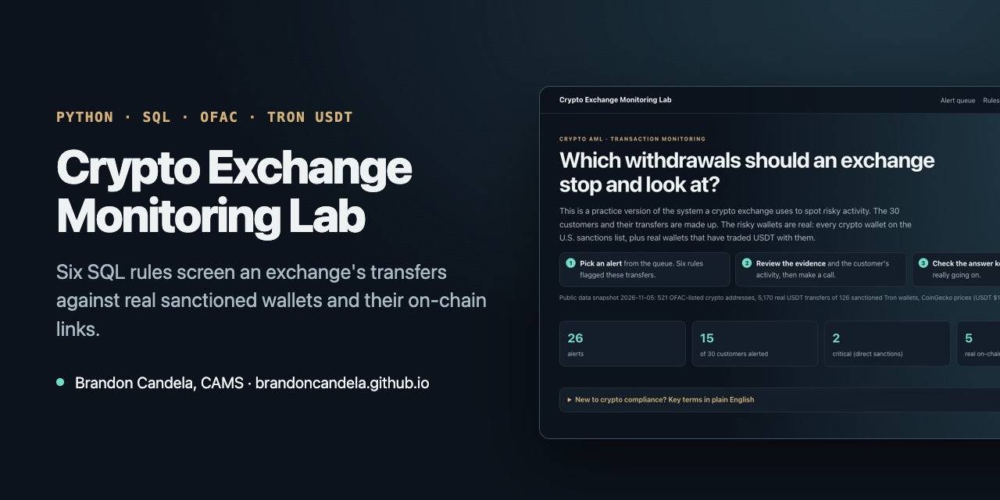

# Crypto Exchange Monitoring Lab



**[▶ Open the live demo](https://brandoncandela.github.io/crypto-exchange-monitoring-lab/)** · [Portfolio](https://brandoncandela.github.io/) · [LinkedIn](https://www.linkedin.com/in/brandon-candela/) · Built by Brandon Candela, CAMS, PMP

[](https://github.com/brandoncandela/crypto-exchange-monitoring-lab/actions/workflows/verify.yml)

> **What this shows:** how a crypto exchange decides which deposits and withdrawals to stop and review, using real sanctions data, six SQL rules and an analyst queue.

## The idea in one paragraph

Every crypto exchange has to watch money coming in and going out for signs of sanctions exposure and money laundering. This project is a small practice version. The exchange and its 30 original customers are fictional. A separate deterministic challenge dataset adds missed cases, overlapping typologies and benign lookalikes. The public evidence is a saved OFAC address list and Tron USDT history. No real wallet is attributed to a fictional customer. Six SQL rules create a review queue with inspectable evidence and synthetic evaluation results.

## Try it in two minutes

1. Open the [live demo](https://brandoncandela.github.io/crypto-exchange-monitoring-lab/).
2. Pick an alert from the queue. The panel explains why it fired, shows the evidence and lists what to check next.
3. Make a call (escalate, ask for information or close it) and write your reasoning.
4. Click **Show answer key** to see what that customer was really doing. Some alerts are false positives on purpose.

## What the six rules look for

| Rule | In plain English | Why it matters |
| --- | --- | --- |
| R01 Direct sanctions exposure | The customer sent crypto to, or got it from, a wallet on the OFAC list. | Dealing with a sanctioned party is prohibited at any amount. |
| R02 One-hop exposure | The other wallet isn't sanctioned, but it has traded USDT directly with one that is. | Money often reaches a sanctioned party through an in-between wallet. This one needs judgment. |
| R03 Pass-through | Most of a deposit leaves again within an hour. | Funds that only pass through an account are a common way to hide where money came from. |
| R04 Structuring | Several withdrawals in a day, each just under $3,000. | $3,000 is where the Travel Rule requires sender and recipient details, so splitting below it can be deliberate. |
| R05 Fan-out | One deposit split to five or more wallets the customer never paid before. | Spreading money across fresh wallets makes it harder to follow. |
| R06 Travel Rule gap | A $3,000+ withdrawal with no recipient details. | A process problem the exchange must fix, even when nothing is suspicious. |

Each rule is one short, commented SQL file in [`sql/rules/`](sql/rules). The numbers you would tune (time windows, dollar amounts) sit in a `params` block at the top of each file.

<!-- results:start -->
## Measured results

### Original baseline fixtures

| Rule | Alerts | Customer precision | Customer recall | Alert precision proxy | Alert recall |
| --- | ---: | ---: | ---: | ---: | --- |
| R01 | 2 | 2/2 (100.0%) | 2/2 (100.0%) | 2/2 (100.0%) | N/A |
| R02 | 4 | 2/3 (66.7%) | 2/2 (100.0%) | 3/4 (75.0%) | N/A |
| R03 | 12 | 2/3 (66.7%) | 2/2 (100.0%) | 2/12 (16.7%) | N/A |
| R04 | 3 | 2/3 (66.7%) | 2/2 (100.0%) | 2/3 (66.7%) | N/A |
| R05 | 3 | 2/3 (66.7%) | 2/2 (100.0%) | 2/3 (66.7%) | N/A |
| R06 | 2 | 2/2 (100.0%) | 2/2 (100.0%) | 2/2 (100.0%) | N/A |

R03 produces 12 alerts across 3 customers. Customer precision is 2/3 (66.7%); alert precision proxy is 2/12 (16.7%). The benign OTC desk contributes 10 repeat alerts.

### Separate challenge evaluation

| Rule | Alerts | Customer precision | Customer recall | Alert precision proxy | Alert recall |
| --- | ---: | ---: | ---: | ---: | --- |
| R01 | 2 | 2/2 (100.0%) | 2/2 (100.0%) | 2/2 (100.0%) | N/A |
| R02 | 1 | 1/1 (100.0%) | 1/1 (100.0%) | 1/1 (100.0%) | N/A |
| R03 | 5 | 3/5 (60.0%) | 3/6 (50.0%) | 3/5 (60.0%) | N/A |
| R04 | 2 | 1/2 (50.0%) | 1/2 (50.0%) | 1/2 (50.0%) | N/A |
| R05 | 2 | 1/2 (50.0%) | 1/2 (50.0%) | 1/2 (50.0%) | N/A |
| R06 | 3 | 3/3 (100.0%) | 3/3 (100.0%) | 3/3 (100.0%) | N/A |

Customer precision = correctly flagged customer–typology pairs / all flagged pairs for that rule.
Customer recall = correctly flagged pairs / all authored positive pairs for that rule.
Alert precision proxy = alerts on customers labeled for that rule / all alerts from that rule.
Repeated alerts count repeatedly in the alert denominator, but once per customer in the customer denominator.
Alert recall is unavailable: there is no exhaustive event-level reference set or count of missed events.
A zero denominator is N/A, not 0% or 100%. All labels express fictional review-worthiness, not confirmed crime.
Cross-rule counts can overlap; do not add customer counts to estimate distinct cases.

Generated by `python3 src/build_lab.py`. Full configurations and results: [`metrics.csv`](dist/data/metrics.csv). [Control-tuning case study](docs/control-tuning.md).
<!-- results:end -->

The interesting part is the false positives. They are realistic customers whose normal business looks suspicious:

- **The OTC desk** creates repeated pass-through alerts; the generated results above show the customer and alert denominators. Consolidating related reviews may reduce repeat work, but an OTC segment alone must not exempt activity. The challenge set includes a review-worthy OTC customer.
- **The payroll company** pays ten contractors $2,600 to $2,950 twice a month. That looks like structuring and, in the first payroll run, like fan-out. The second run doesn't trigger fan-out because the wallets are no longer new.
- **The busy wallet** has traded more than 6 million USDT with 19 sanctioned wallets. That pattern is typical of a large service such as an exchange, but the lab doesn't claim to know who controls it. An analyst would have to find out.

## Where the data comes from

| Data | Source | Real or made up |
| --- | --- | --- |
| Sanctions address records (521 entries; 514 distinct addresses) | [OFAC SDN list](https://sanctionssearch.ofac.treas.gov/) | Real |
| USDT transfers of sanctioned Tron wallets (5,170) | [TronGrid](https://www.trongrid.io/) public API | Real |
| Prices used to value transfers in dollars | [CoinGecko](https://www.coingecko.com/) | Real, as of the snapshot |
| Customers, their deposits and withdrawals, transaction IDs | Generated by `src/build_lab.py` | Made up |

The public data was saved on November 5, 2026 in [`data/snapshot/`](data/snapshot), so the lab rebuilds the same way every time, even offline. Run `python3 src/snapshot.py` to refresh it.

A transfer with a sanctioned wallet is a reason to look closer. It is not proof that anyone did something wrong, and nothing here should be read as an accusation against the owner of any real wallet.

## How it's built

- **Python** (standard library only) downloads the public data and builds a fictional exchange ledger on top of it.
- **SQLite** holds the data. The rules are plain SQL using joins, CTEs, window functions (`ROW_NUMBER`) and JSON output.
- **Tests** use Python's built-in `unittest`. Each rule is tested right at its edges: 79% vs. 80% withdrawn, 60 vs. 61 minutes, $2,999.99 vs. $3,000. A build test checks that results are identical on every run and that ordinary customers never alert.
- **The demo** is one HTML page with plain JavaScript and CSS. No framework, no server, no API keys.

```bash
python3 src/build_lab.py                      # rebuild dist/data/lab.json from the snapshot
python3 -m unittest discover -s tests -v      # rule, evaluation, export and regression checks
python3 scripts/check_outputs.py             # fail if committed outputs do not reproduce
python3 -m http.server 8000 --directory dist  # then open http://localhost:8000
```

| Path | What's in it |
| --- | --- |
| `src/snapshot.py` | Downloads the OFAC addresses, Tron transfers and prices |
| `src/build_lab.py` | Builds the fictional exchange, runs the rules, scores them |
| `sql/schema.sql` | Tables for customers, transfers, sanctioned addresses and on-chain transfers |
| `sql/rules/` | One SQL file per rule |
| `tests/` | Rule boundary tests and build checks |
| `dist/` | The demo page published to GitHub Pages |

## Design decisions and validation

- **Scenario scope:** six SQL controls separate direct sanctions exposure, weaker one-hop links, behavioral patterns and missing beneficiary data. Review priority is different from confirmed illicit activity. Public blockchain records are evidence only; customer transfers and their TX IDs are fictional.
- **Thresholds:** R03 uses a $1,000 floor, 80% share and 60-minute window. Other SQL `params` blocks expose each rule's assumptions. These are illustrative scenario boundaries, not calibrated legal or production standards.
- **Tradeoffs:** repeated OTC settlement inflates alert workload without adding customers. A separate $50,000-floor what-if exposes the cost of reducing volume. Timing/amount matching cannot establish fund continuity; one-hop links do not establish wallet ownership.
- **Validation:** original baseline generation is preserved with ledger and alert regression fingerprints. A separate deterministic challenge set supports multiple labels per customer, intentional misses and exact boundaries. Scoring is downstream of detection. These authored fixtures are not a blind holdout or evidence of real-world accuracy.
- **AI assistance:** AI coding tools assisted implementation, tests and documentation. Claims here describe inspectable repository behavior, not independently verified personal authorship, employer results or a production system. Review SQL, generated evidence and limitations before relying on conclusions.

## Interview materials

- [Control-tuning case study](docs/control-tuning.md): actual runs, explicit denominators, workload assumptions, approval, monitoring and rollback.
- [90-second walkthrough script](docs/walkthrough.md): alert, evidence, innocent explanation, disposition and limitation. Ready to record; no video or fabricated voice is included.
- [Metrics CSV](dist/data/metrics.csv) and separate JSON runs in `dist/data/` preserve dataset and control identity.

## Continuous verification and deployment

GitHub Actions rebuilds offline from the committed snapshot, runs tests, checks JavaScript syntax and compares generated JSON, CSV and documentation with committed outputs. The badge tracks **main**, so an unmerged PR does not imply a passing main build. PR results are visible in Checks. The workflow does not deploy or refresh public data; existing GitHub Pages behavior is unchanged.

## What it doesn't do

- **It only follows one hop.** Real tools trace funds through many wallets. One hop keeps every alert explainable.
- **It only traces Tron USDT history.** Ethereum addresses on the OFAC list are screened directly, but their transaction history isn't pulled, because that needs a paid or keyed API.
- **It doesn't attribute wallets.** Commercial tools label wallets as exchanges, mixers or scams. This lab shows the raw links and leaves the judgment to the analyst.
- **Prices are a single snapshot**, not the price at the time of each transfer.

## License

MIT. Built with AI coding tools.
